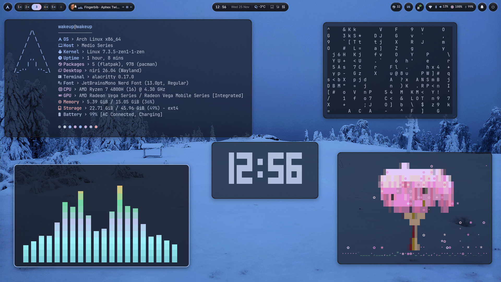
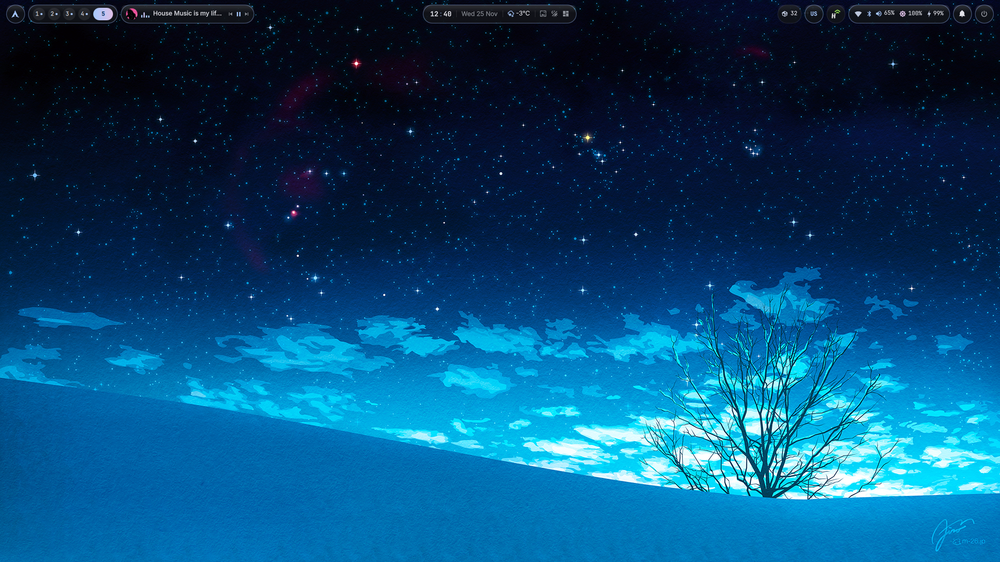
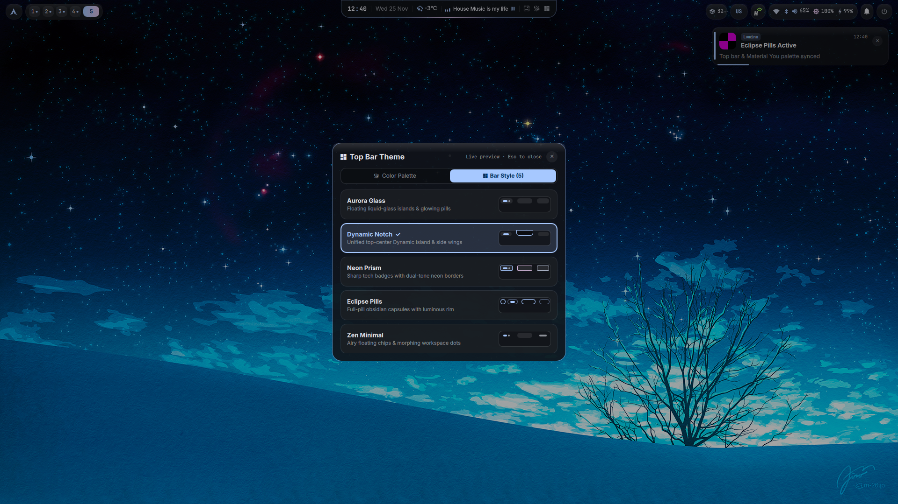

# Lumina — Niri + Arch Linux Dotfiles

A lightweight, **Niri-native** desktop shell built with **Quickshell (Qt6/Wayland)**, **Material You (`matugen`)**, and liquid-glass aesthetics. Engineered for zero-polling reactivity, low memory footprint, and 200Hz fluidity.



---

## Previews

| Desktop & Backdrop (`Eclipse Pills`) | Bento Control Center & Notifications |
|---|---|
|  |  |

| 5 Switchable Top Bar Themes (`Super+Alt+B`) | Slanted Wallpaper Carousel (`Super+W`) |
|---|---|
|  |  |

| Command Palette (`Super+D`) | |
|---|---|
|  | |

---

## 5 Top Bar Themes (`Super + Alt + B`)

Switch live between **5 animated bar layouts** in `<1ms` via the Bar Style Switcher (`Super+Alt+B`), right-clicking `󰕮` in the bar, the Control Center header pill, or `rice-bar-style <name|next>`:

| ID | Name | Style |
|---|---|---|
| `aurora` | **Aurora Glass** | Floating liquid-glass islands with top specular sheen and spring workspace pills |
| `notch` | **Dynamic Notch** | Unified top-center Dynamic Island (clock, weather, live media visualizer) + floating wings |
| `cyber` | **Neon Prism** | Sharp chamfered geometry with dual-tone accent borders & neon active underlines |
| `eclipse` | **Eclipse Pills** | Full-pill deep obsidian capsules with luminous accent rims & circular action buttons |
| `minimal` | **Zen Minimal** | Airy translucent layout with morphing workspace dots & hover-revealed metrics |

---

## Architecture & Performance

Instead of running separate bar/OSD/notification/tray daemons and polling shell scripts every second, **Lumina** consolidates the desktop shell into one lean Quickshell process backed by native C++ Wayland/D-Bus services and `LazyLoader` overlays:

- **Zero-Polling Niri IPC (`services/Niri.qml`)**: A persistent `niri msg --json event-stream` listener updates workspaces, active window titles, keyboard layout (`US`/`RU`), overview state, and screencast indicators with `<1ms` latency.
- **Native Quickshell Services**: `Pipewire` (`PwObjectTracker`), `Mpris`, `Notifications`, `SystemTray`, `UPower`, `Networking`, `Bluetooth`, `Polkit`, and `IdleInhibitor` run directly in C++ without spawning `pactl`/`playerctl`/`swaync` subprocesses.
- **On-Demand Subsystems**: `cava` audio spectrum and `/proc/stat` system vitals **only run while the Control Center / Backdrop is visible** (`0%` idle background CPU).
- **Lazy-Loaded Overlays**: Launcher, Slanted Wallpaper Carousel, Control Center, Clipboard History, Power Menu, and Theme/Bar Switcher consume `0 MB` until opened.
- **Footprint (measured via `systemd` cgroup)**: `~145 MB` total for Bar + OSD + Notifications + Tray + Polkit + MPRIS + PipeWire + Niri IPC (down from `~301 MB` across Waybar + SwayNC + SwayOSD + Blueman).

---

## Key Features

- **Animated Glass Top Bar (`Bar.qml`)**: Spring-animated Niri workspace pills, live MPRIS media capsule with 4-bar animated equalizer, breathing clock, weather, active Pomodoro badge, instant `US`/`RU` layout switcher, system tray, hardware status island, and pulsing unread notification bell.
- **Bento Control Center & Notification Hub (`ControlCenter.qml`)**:
  - **Left Column**: Dedicated Notification Center (DND toggle, clear all, urgency stripes, app icons, inline action buttons) + live **System Vitals** (`CPU %`, `RAM %`, `°C`).
  - **Right Column**: Uniform 4×2 Quick Toggles (Wi-Fi + inline network list, Bluetooth + paired devices, Night Light via `wlsunset`, Caffeine `IdleInhibitor`, DND, Mic Mute, Region Screenshot, Color Picker), Volume & Backlight sliders + PipeWire sink selector.
  - **Studio / Focus / Notes**: Spinning album vinyl with live 18-bar `cava` spectrum & scrubber, 25m/5m Pomodoro Focus timer synced to the top bar, and auto-saving Scratchpad (`~/.local/share/lumina/notes.md`).
- **Animated Notification Popups (`NotificationPopups.qml`)**: Slide-in glass toasts with urgency stripes, hover-to-pause timer bar, and interactive action buttons.
- **Slanted Parallelogram Wallpaper Carousel (`WallpaperCarousel.qml`)**: Hardware-accelerated affine skew cards, incremental 320×180 thumbnail & color-bucket indexing (`Curated` / `All`, 9 color filters, live search, random shuffle), smooth `awww` transitions, and instant `matugen` recoloring across Shell, Niri borders, Alacritty, Kitty, Hyprlock, and Rofi.
- **Command Palette (`Launcher.qml`)**: Fuzzy app search via native `DesktopEntries`, `@` live Niri window switcher, `=` math evaluator, and `>` quick shell runner.
- **Smart Hardware Ergonomics**: Niri `switch-events` automatically disables `eDP-1` on lid close and re-enables it on lid open.

---

## Keybinds Reference

> Press **`Super + Shift + /`** (`?`) at any time to open Niri's built-in hotkey overlay.

### Lumina Shell & Overlays

| Shortcut | Action |
|---|---|
| `Super + D` | Lumina Launcher & Command Palette (`@` windows, `=` calc, `>` cmd) |
| `Super + N` | Bento Control Center & Notification Hub |
| `Super + W` | Slanted Wallpaper Carousel |
| `Super + Alt + W` | Apply random wallpaper + Material You recolor |
| `Super + Alt + T` | Color Theme Switcher (`Matugen Dynamic` + 5 presets) |
| `Super + Alt + B` | Top Bar Theme Switcher (`Aurora`, `Notch`, `Cyber`, `Eclipse`, `Minimal`) |
| `Super + V` | Clipboard History (`cliphist`) |
| `Super + Escape` | Power Menu (`1`–`5` quick keys) |
| `Super + L` / `Super + Alt + L` | Lock Screen (`hyprlock`) |

### Applications & Utilities

| Shortcut | Action |
|---|---|
| `Super + Return` / `Super + T` | Open Terminal (`alacritty`) |
| `Super + B` | Open Browser (`zen-browser`) |
| `Super + E` | Open File Manager (`nautilus`) |
| `Super + Shift + S` | Region Screenshot (clipboard + save + Satty action) |
| `Super + Shift + A` | Region Screenshot & annotate immediately in Satty |
| `Super + Shift + C` | Color Picker (`hyprpicker`) |
| `Print` / `Ctrl + Print` / `Alt + Print` | Native Niri screenshot (region / screen / window) |

### Windows, Floating & Layout (Niri)

| Shortcut | Action |
|---|---|
| `Super + Q` / `Super + C` | Close focused window |
| `Super + O` | Toggle Workspaces Overview |
| `Super + Alt + F` | Toggle window floating / tiling |
| `Super + Shift + V` | Switch focus between floating and tiling layers |
| `Super + Left Click (drag)` | Move floating window |
| `Super + Right Click (drag)` | Resize floating window |
| `Super + F` | Maximize column |
| `Super + Shift + F` | Fullscreen window |
| `Super + M` | Maximize window to screen edges |
| `Super + Ctrl + F` | Expand column to available width |
| `Super + Shift + O` | Toggle inactive opacity rule on focused window |
| `Super + W` | Toggle tabbed column display |
| `Super + R` / `Super + Shift + R` | Cycle preset column widths (`1/3`, `1/2`, `2/3`) |
| `Super + Ctrl + R` / `Super + Ctrl + Shift + R` | Reset / cycle window height |
| `Super + -` / `Super + =` | Decrease / increase column width (`±10%`) |
| `Super + Shift + -` / `Super + Shift + =` | Decrease / increase window height (`±10%`) |
| `Super + [` / `Super + ]` | Consume or expel window left / right |
| `Super + ,` / `Super + .` | Consume window into column / expel from column |

### Focus, Workspaces & Monitors

| Shortcut | Action |
|---|---|
| `Super + H/J/K/L` or `Arrow Keys` | Focus column left/right or window up/down |
| `Super + Ctrl + H/J/K/L` or `Arrows` | Move column left/right or window up/down |
| `Super + Home` / `Super + End` | Focus first / last column (`+ Ctrl` to move) |
| `Super + 1`–`9` | Focus workspace `1`–`9` (`+ Ctrl` to move column) |
| `Super + U` / `Super + I` or `Page_Down` / `Page_Up` | Focus workspace down / up (`+ Ctrl` move column, `+ Shift` move workspace) |
| `Super + Wheel Scroll` | Switch workspaces (`+ Ctrl` move column, `+ Shift` scroll columns) |
| `Super + Shift + H/J/K/L` or `Arrows` | Focus monitor (`+ Ctrl` move column to monitor) |

### Media, Hardware & Session

| Shortcut | Action |
|---|---|
| `Super + Space` | Switch keyboard layout (`US` ↔ `RU`) |
| `XF86AudioRaiseVolume` / `LowerVolume` / `Mute` | Volume control with OSD |
| `XF86AudioMicMute` | Toggle microphone mute with OSD |
| `XF86MonBrightnessUp` / `Down` | Display brightness control with OSD |
| `XF86AudioPlay` / `Stop` / `Prev` / `Next` | MPRIS media playback controls |
| `Super + Shift + P` | Power off monitors |
| `Super + Shift + E` / `Ctrl + Alt + Delete` | Quit Niri session |

---

## Installation (Arch Linux)

```bash
git clone https://github.com/ascoler/lumina-niri.git ~/dotfiles
cd ~/dotfiles
chmod +x install.sh
./install.sh
```

Existing configs are backed up automatically to `~/.config_backup_<timestamp>/` before symlinking.

### CLI Helpers (`~/.local/bin/`)

- `rice-theme [preset]` — Open Color Theme Switcher or apply a palette preset (`Matugen Dynamic`, `Catppuccin Mocha`, `Tokyo Night`, `Nord`, `Gruvbox Dark`, `Lucid Material 3`)
- `rice-bar-style [aurora|notch|cyber|eclipse|minimal|next]` — Open Bar Style Switcher, apply a style, or cycle
- `rice-wallpaper [path]` — Open/apply wallpaper and regenerate Material You theme
- `rice-screenshot [region|annotate]` — Region capture via `grim` + `slurp` + `satty`
- `rice-colorpicker` — Wayland hex color picker via `hyprpicker`
