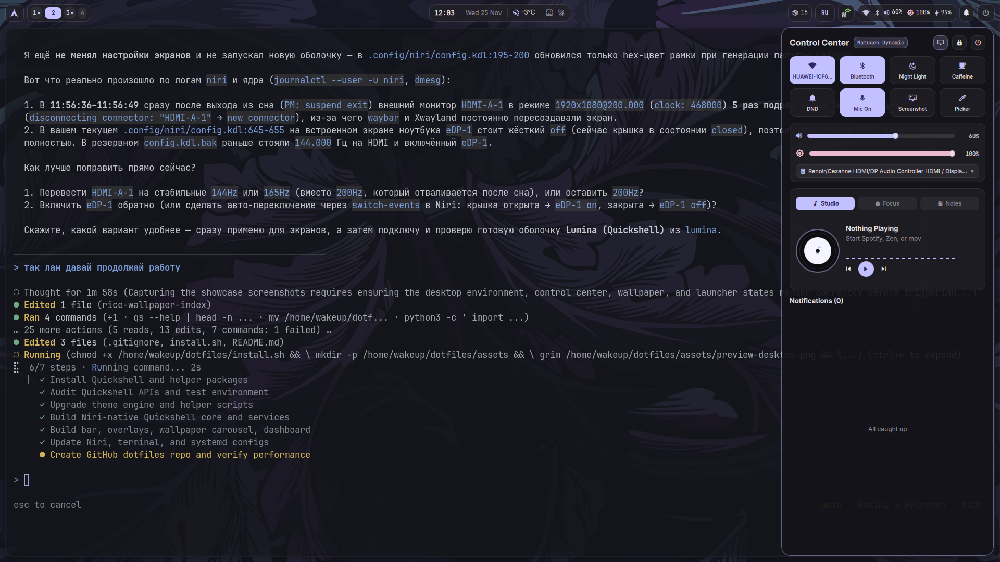
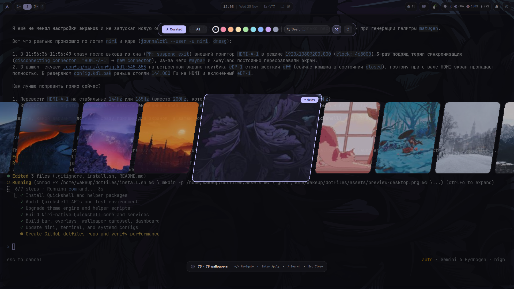
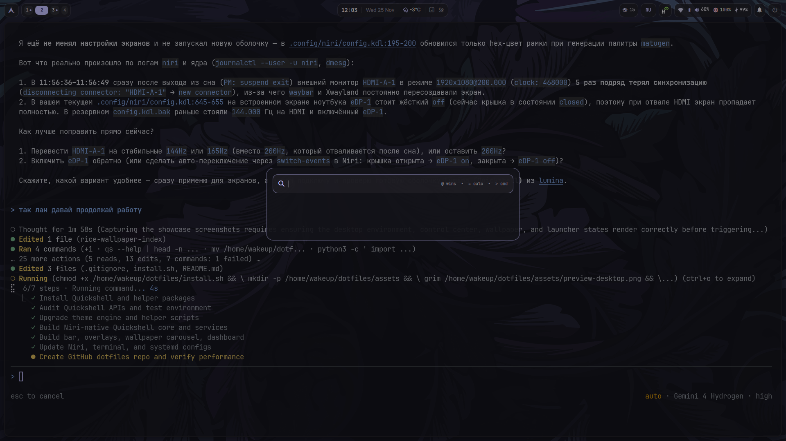

# Lumina — Niri + Arch Linux Dotfiles

A lightweight, **Niri-native** desktop shell built with **Quickshell (Qt6/Wayland)**, **Material You (`matugen`)**, and glassmorphic design. Engineered for zero-polling reactivity, low memory footprint, and 200Hz fluidity.

## Previews

| Desktop & Bar | Control Center & Vinyl Studio |
|---|---|
|  |  |

| Slanted Wallpaper Carousel | Command Palette (`Super+D`) |
|---|---|
|  |  |

---

## Architecture & Performance

Instead of running five separate bar/OSD/notification/tray daemons and polling shell scripts every second, **Lumina** consolidates the desktop shell into one lean Quickshell process backed by native C++ Wayland/D-Bus services and `LazyLoader` overlays:

- **Zero-Polling Niri IPC (`services/Niri.qml`)**: A single persistent `niri msg --json event-stream` listener updates workspaces, active window titles, keyboard layout (`US`/`RU`), overview state, and screencast indicators with `<1ms` latency.
- **Native Quickshell Services**: `Pipewire` (`PwObjectTracker`), `Mpris`, `Notifications`, `SystemTray`, `UPower`, `Networking`, `Bluetooth`, `Polkit`, and `IdleInhibitor` run directly in C++ without spawning `pactl`/`playerctl`/`swaync` subprocesses.
- **On-Demand Subsystems**: `cava` audio spectrum and `/proc/stat` system vitals **only run while the Control Center / Backdrop is visible** (`0%` idle background CPU).
- **Lazy-Loaded Overlays**: Launcher, Slanted Wallpaper Carousel, Control Center, Clipboard History, Power Menu, and Theme Switcher consume `0 MB` until opened.
- **Footprint (measured via `systemd` cgroup)**: `~145 MB` total for Bar + OSD + Notifications + Tray + Polkit + MPRIS + PipeWire + Niri IPC (down from `~301 MB` across Waybar + SwayNC + SwayOSD + Blueman).

---

## Key Features

- **Floating Glass Top Bar (`Bar.qml`)**: Niri workspace pills with window indicators, live MPRIS media pill, clock/date/weather, active Pomodoro badge, instant `US`/`RU` layout switcher, system tray, hardware status island, and notification bell.
- **Slanted Parallelogram Wallpaper Carousel (`WallpaperCarousel.qml`)**: Hardware-accelerated affine skew cards, incremental 320x180 thumbnail & dominant color-bucket indexing (`Curated` / `All`, 9 color filters, live search, random shuffle), smooth `awww` transitions, and instant `matugen` recoloring across Shell, Niri borders, Alacritty, Kitty, Hyprlock, and Rofi.
- **Control Center & Studio (`ControlCenter.qml`)**:
  - 4x2 Quick Toggles (Wi-Fi + inline network list, Bluetooth + paired devices, Night Light via `wlsunset`, Caffeine `IdleInhibitor`, DND, Mic Mute, Region Screenshot, Color Picker).
  - Volume & Backlight sliders + collapsible PipeWire sink switcher.
  - **Vinyl + Cava Studio**: Spinning album vinyl with live 18-bar Cava spectrum and seekable scrubber.
  - **Focus Timer**: Built-in 25m/5m Pomodoro timer synced to the Top Bar.
  - **Scratchpad**: Persistent auto-saving notes (`~/.local/share/lumina/notes.md`).
- **Command Palette (`Launcher.qml`)**:
  - Fuzzy app search via native `DesktopEntries`.
  - `@` prefix — Live Niri Window Switcher across all workspaces.
  - `=` prefix — Instant math evaluator (`Enter` copies result).
  - `>` prefix — Quick shell runner.
- **Smart Hardware Ergonomics**: Niri `switch-events` automatically disables `eDP-1` on lid close and re-enables it on lid open.

---

## Keybinds

| Shortcut | Action |
|---|---|
| `Super + Return` / `Super + T` | Open Alacritty |
| `Super + D` | Lumina Command Palette (`@` windows, `=` calc, `>` cmd) |
| `Super + W` | Slanted Wallpaper Carousel |
| `Super + Alt + W` | Random Wallpaper + Material You Recolor |
| `Super + Alt + T` | Color Theme Switcher (Matugen + 5 Presets) |
| `Super + N` | Control Center & Notification History |
| `Super + V` | Clipboard History (`cliphist`) |
| `Super + O` | Niri Workspaces Overview (with Backdrop Widgets) |
| `Super + Shift + S` | Region Screenshot (Clipboard + Save + Satty action) |
| `Super + Shift + A` | Screenshot & Annotate immediately in Satty |
| `Super + Shift + C` | Color Picker (`hyprpicker`) |
| `Super + L` | Lock Screen (`hyprlock`) |
| `Super + Escape` | Power Menu (`1`–`5` quick keys) |

---

## Installation (Arch Linux)

```bash
git clone https://github.com/<your-username>/lumina-niri.git ~/dotfiles
cd ~/dotfiles
chmod +x install.sh
./install.sh
```

Existing configs are backed up automatically to `~/.config_backup_<timestamp>/` before symlinking.
